# Project Big Picture

This project is a small but complete Django web application: a shop where visitors browse a product
catalog, fill a basket and place an order that is paid from prepaid credit. The point is not to show
individual Django features, but **how the parts of a server-side Python application fit together**.

The diagrams in this document are [Mermaid](https://mermaid.js.org/) diagrams. GitHub, GitLab, VS Code
(with a Markdown preview extension) and PyCharm render them directly; nothing has to be generated.

The one idea to take away: **separation of responsibilities**. Every module has one job. When the
application grows, you do not add code to the biggest file — you add it to the layer that owns the
responsibility.

---

## 1. What The Application Does

The domain is a shop. Its vocabulary is defined in [CONTEXT.md](./CONTEXT.md), and code, templates and
documentation all use those words.

- A **Product** is one offering in the catalog, with a name, a description and a price.
- A **Customer** is a person who can log in and place orders; they own a **Credit**.
- A **Basket** holds the products a visitor intends to order. It lives in the session, not in the database.
- An **Order** is a placed and paid basket. It consists of **Order Positions** (one per distinct product).

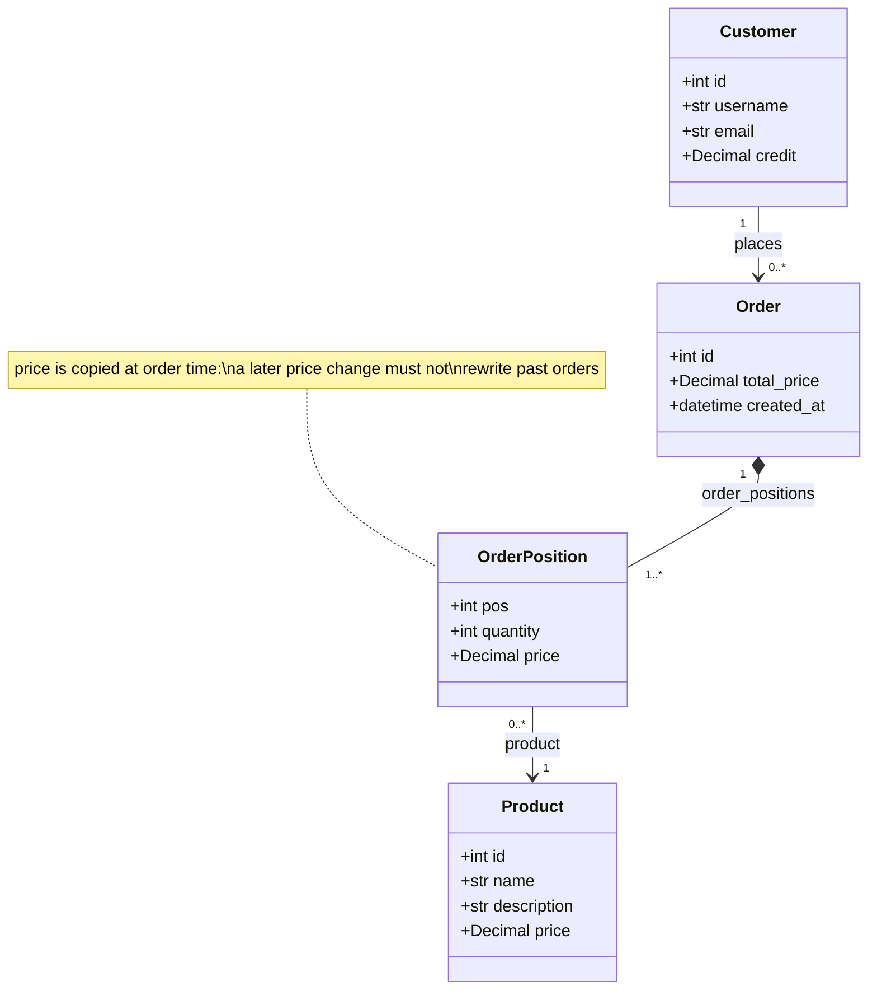

One customer can place many orders; each order belongs to exactly one customer. An order consists of
several positions, and each position refers to one product with a quantity and the unit price **at the
time of ordering**. That copied price is a deliberate domain decision, not an optimisation.

The application is reached in one way only: **server-rendered HTML pages**. There is no REST API in this
project (`djangorestframework` is installed but currently unused) — adding one is a natural exercise,
and it would reuse exactly the same services as the pages.

---

## 2. The Big Picture

Read the diagram from the outside (the browser) toward the database and back. Arrows mean *"may call"*,
not *"every request goes through here"*.

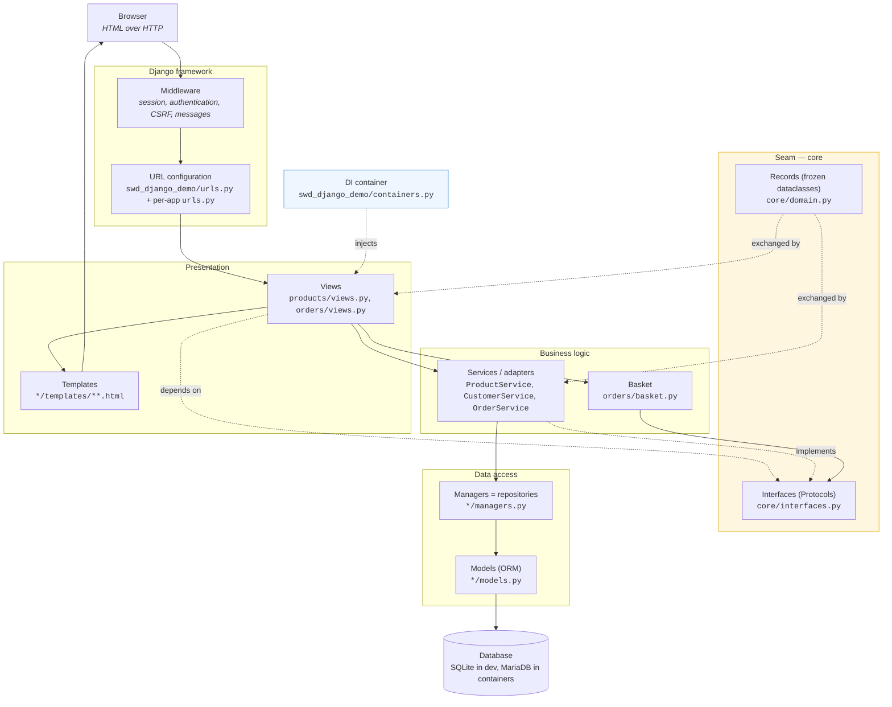

Two things distinguish this project from a textbook Django app:

1. **The views never see a model.** They receive `CatalogItem`, `CustomerInfo`, `OrderSummary` — plain
   frozen dataclasses from `core/domain.py`. Only the adapters (services) touch Django models.
2. **The views never construct a service.** The dependency-injection container hands the service in.

---

## 3. The Django Apps

A Django project is a collection of *apps*. Each app is a Python package with its own models, views,
URLs, templates and tests.

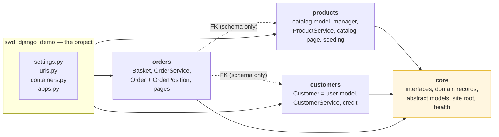

Note what the dashed arrows mean: `orders` depends on `products` and `customers` only through the
foreign keys of its models (and therefore its migrations). Its code never imports another app's models:
the services, views and basket depend on `core.interfaces` and get the concrete adapter injected. That is
the architectural idea of this project — data may be linked, behaviour goes through the seams.

| App | Responsibility |
|---|---|
| `core` | The seams: `interfaces.py` (Protocols), `domain.py` (records + errors), abstract base models, site root redirect, `/health`. |
| `products` | Product catalog: `Product` model, `ProductManager` (repository), `ProductService` (adapter), `/products/` page, `seed_catalog` command. |
| `customers` | `Customer` — at the same time the Django user model — plus `CustomerService` for credit redemption. |
| `orders` | `Basket` (session), `OrderService` (placement + history), `Order`/`OrderPosition` models, pages under `/orders/`. |
| `swd_django_demo` | The project itself: settings, root URLs, the DI container and the composition root. |

---

## 4. Application Startup

There is no `main()`. Django is started by a *management command* (`manage.py runserver`) or by a WSGI
server (gunicorn in the container setup). Startup does this:

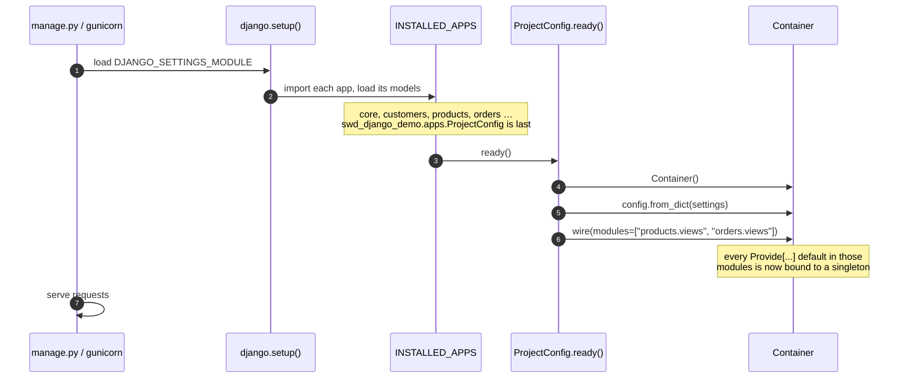

`swd_django_demo/apps.py` is the **composition root** — the single place where the application decides
which concrete implementation satisfies which interface. It must stay **last** in `INSTALLED_APPS`,
because `ready()` is only allowed to import models after every app has been loaded.

### Dependency Injection

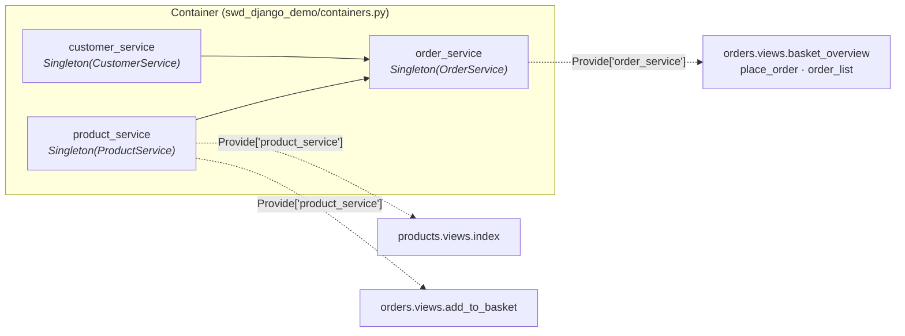

A view declares what it needs as a parameter with a default:

```python
@inject
def index(request, product_service: ProductCatalog = Provide["product_service"]) -> HttpResponse:
    ...
```

Why bother? The view depends on the **interface** `ProductCatalog`, never on `ProductService`. A test can
call `index(request, product_service=FakeCatalog())` without a database, and production can swap the
catalog implementation by changing one line in the container. This is the same reason Spring uses
`@Autowired` — Python just needs an explicit library
([dependency-injector](https://python-dependency-injector.ets-labs.org/)) because it has no built-in one.

---

## 5. The Layers

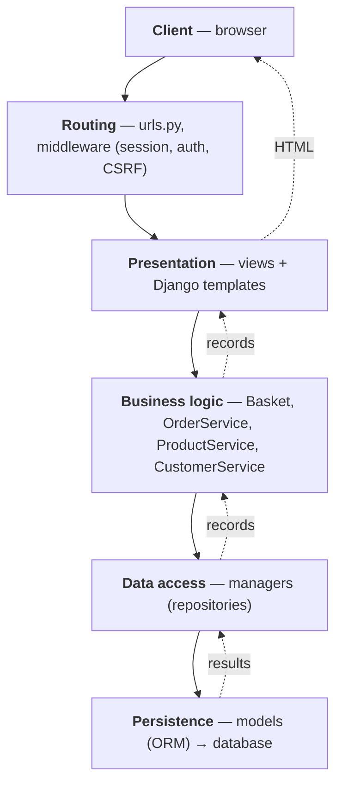

Requests travel down, results travel back up. Settings, the DI container and the tests support the whole
stack and are therefore not drawn as part of the runtime path.

### 5.1 URL Configuration

```text
swd_django_demo/urls.py      the root URLconf
core/urls.py                 ""  → redirect to products, /health, /logout
products/urls.py             /products/
orders/urls.py               /orders/…
```

The root URLconf only `include()`s the apps' own URL modules, so every app owns its URLs. Each app sets
an `app_name`, which is why templates can write `` instead of hard-coded
paths. Change a path, and every link follows.

| URL | View | Purpose |
|---|---|---|
| `/` | `core.index_view.index` | Redirects to the catalog. |
| `/health` | `core.views.health_check` | JSON health probe for the container healthcheck: 200 when the database answers, 503 otherwise. |
| `/products/` | `products.views.index` | The catalog page. |
| `/orders/add_to_basket` | `orders.views.add_to_basket` | POST, adds one product to the session basket. |
| `/orders/basket_overview` | `orders.views.basket_overview` | The priced basket. |
| `/orders/place_order` | `orders.views.place_order` | Login required, turns the basket into an order. |
| `/orders/clear_basket` | `orders.views.clear_basket` | POST, empties the basket. |
| `/orders/my` | `orders.views.order_list` | Login required, the customer's order history. |
| `/admin/` | Django admin | Product and customer maintenance, and the login page. |

### 5.2 View Layer

Views are the entry point for HTTP requests. A view in this project does three things and nothing more:
read the request, call a service, render a template.

```python
@login_required
@inject
def order_list(request, order_service: OrderService = Provide["order_service"]) -> HttpResponse:
    context = {"orders": order_service.get_orders(request.user)}
    return HttpResponse(loader.get_template("orders/order_list.html").render(context, request))
```

Notice what is **not** there: no query, no pricing rule, no transaction. `place_order` is the one view
with visible control flow, and even that is only translation — it catches `OrderError` and turns it into a
user message:

```python
try:
    order = order_service.create_order(request.user, basket)
    basket.clear()
    messages.success(request, f"Thank you! Your order #{order.pk} has been placed.")
except OrderError as e:                    # expected business outcome → message
    messages.error(request, str(e))        # anything else is a bug → 500
```

### 5.3 Service Layer

Services hold the business logic. Each one is a plain Python class — no Django base class, no framework
magic.

| Service | Responsibility |
|---|---|
| `products.services.ProductService` | Adapter for `ProductCatalog`: reads products and converts them to `CatalogItem` records. The conversion is where a pricing policy would live. |
| `customers.services.CustomerService` | Adapter for `Customers`: `redeem_credit()` locks the customer row, checks the credit and deducts it, or raises `InsufficientCredit` without writing anything. |
| `orders.services.OrderService` | Prices a basket, lists the order history and — in `create_order` — owns the one transaction that places an order. |
| `orders.basket.Basket` | Not injected but constructed from the session. Owns the session key and the pricing of raw product ids into `OrderLine`s. |

`OrderService` shows the rule most clearly:

```python
def __init__(self, product_service: ProductCatalog, customer_service: Customers):
```

It is typed against the *interfaces*. It never imports `products.models` or `customers.models`, which is
why its tests can hand it an in-memory catalog or a mock instead of the real adapter.

### 5.4 Repository Layer — Managers

Django has no separate repository class; the equivalent is a model **manager**, reachable as
`Product.objects`. The default manager already provides `all()`, `filter()`, `get()`, `create()`,
`update_or_create()`, `delete()`. Custom query methods are added by subclassing:

```python
class ProductManager(CoreProductManager):
    def get_by_id(self, id: int) -> Optional["Product"]:
        return self.get_queryset().filter(id=id).first()

    def get_by_price_range(self, min_price: Decimal, max_price: Decimal) -> QuerySet["Product"]:
        return self.get_queryset().filter(price__gte=min_price, price__lte=max_price)
```

Keeping queries in the manager means an SQL-shaped concern stays in one place instead of being spread
over the services. `CustomerManager` additionally extends Django's `UserManager`, because
`manage.py createsuperuser` needs `create_user`/`create_superuser`.

### 5.5 Model Layer

Models are the ORM classes; each non-abstract model maps to one database table.

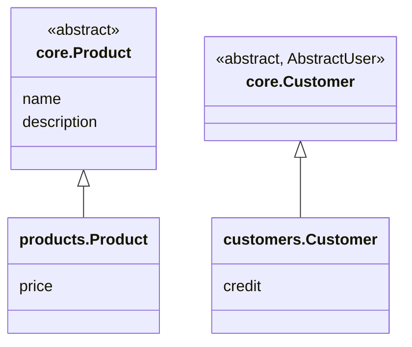

The important mechanisms:

- **Abstract models** (`class Meta: abstract = True`) get no table of their own; their fields are copied
  into every subclass. `core.models.Product` and `core.models.Customer` define what *every* product or
  customer has.
- **Foreign keys across apps.** `orders/models.py` references the other apps by string:
  `ForeignKey("products.Product", …)` and `ForeignKey(settings.AUTH_USER_MODEL, …)`. A string reference
  needs no import, so the orders code stays free of other apps' models; the dependency shows up only in the
  schema and in the migration's `dependencies`. `AUTH_USER_MODEL = "customers.Customer"` is Django's
  documented way to replace the built-in user model.
- **`on_delete=PROTECT`** on the product and customer foreign keys: a product that appears in an order
  must not vanish, or the order history would be falsified. `OrderPosition` uses `CASCADE` towards its
  order, because a position has no meaning without it.
- **`unique_together = (("order", "pos"),)`** substitutes for the composite primary key Django does not
  support.

### 5.6 The Seam — Interfaces and Records

This is the layer a Spring project would call "interfaces and DTOs", and it is worth a close look.

**Interfaces are `typing.Protocol`s** (PEP 544). An adapter satisfies one simply by having the right
methods — no `implements`, no inheritance:

```python
@runtime_checkable
class ProductCatalog(Protocol):
    def get_all_products(self) -> list[CatalogItem]: ...
    def get_product(self, product_id) -> Optional[CatalogItem]: ...
```

**Records are frozen dataclasses** in `core/domain.py`: `CatalogItem`, `CustomerInfo`, `OrderLine`,
`OrderSummary`. They are the Python counterpart of DTOs, and they exist for concrete reasons:

- A Django model is an *Active Record*: bound to the database, no `id` before saving, foreign keys not
  followable before saving. The basket must be **priced without writing anything**, so it cannot use
  models.
- `frozen=True` means a record cannot change under the caller's feet — the price shown in the basket is
  the price that was looked up.
- `slots=True` turns a typo like `item.pric = 1` into an error instead of a silent new attribute.

**Business failures are exceptions**, also in `core/domain.py`:

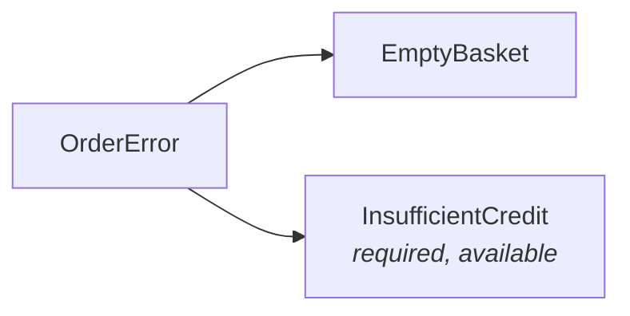

Services raise the specific type; views catch the base type `OrderError`. Anything else that escapes is a
bug and correctly becomes a 500.

An **entity describes how data is stored, a record describes how data is transferred.** Mixing the two is
the most common way a layered application quietly loses its layers.

### 5.7 Templates And Static Files

```text
core/templates/core/base.html            the layout: navigation, messages, footer
products/templates/products/index.html   the catalog
orders/templates/orders/basket_overview.html
orders/templates/orders/order_list.html
static/                                  Bootstrap, icons, application.css, theme.js
static_dir/                              collectstatic output, served by nginx in the container setup
```

Templates are rendered **on the server**. The view fills a context dictionary, the template reads it with
`{{ … }}`, ``, `` and extends the layout with ``.

One value reaches every template without any view passing it: `basket_count`. That is a **context
processor** (`orders/context_processors.py`, registered in `settings.TEMPLATES`), which is the right tool
for something the layout needs everywhere — here the badge in the navigation bar.

### 5.8 Authentication And Access Control

There is no separate security layer in this project; Django's middleware and decorators do the work.

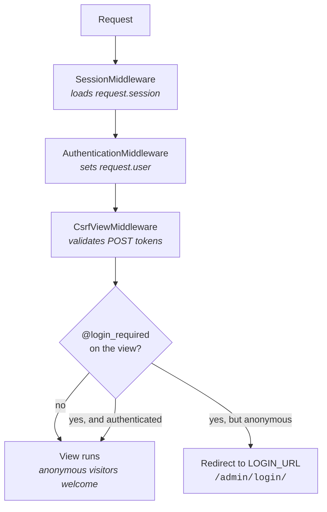

- Browsing the catalog and filling a basket work **without login** — a visitor has a session, not an
  account.
- `place_order` and `order_list` carry `@login_required`: they need a customer with credit and an owner
  for the order.
- The `/admin/` site is protected by Django's own staff check, and it doubles as the login page
  (`LOGIN_URL = "/admin/login/"` — convenient for a lab, not something to copy into production).
- Every view that changes state (`add_to_basket`, `clear_basket`, `place_order`) accepts only POST and is
  protected by Django's CSRF middleware; the forms render ``. A good discussion topic: what
  could an attacker do if `clear_basket` were a plain GET link, or if a view were `@csrf_exempt`?

### 5.9 Settings And Configuration

`swd_django_demo/settings.py` is the development configuration (SQLite, `DEBUG = True`, a checked-in
development key that `DJANGO_SECRET_KEY` overrides). `settings_prod.py` is the container variant: it imports
everything from `settings.py` and only overrides what differs (MariaDB, no debug, allowed hosts). Its secrets
come from the environment — `DJANGO_SECRET_KEY` and `DJANGO_DB_PASSWORD` are required, the container refuses
to start without them. The Dockerfile selects it with `DJANGO_SETTINGS_MODULE=swd_django_demo.settings_prod`,
and `containers/compose.yaml` passes the secrets (with local-only defaults, override them in your shell or in
`containers/.env`). Settings worth knowing:

| Setting | Effect |
|---|---|
| `INSTALLED_APPS` | Which apps exist. `ProjectConfig` must remain last. |
| `AUTH_USER_MODEL = "customers.Customer"` | Makes the shop's customer *the* user of the project. |
| `TEMPLATES.OPTIONS.context_processors` | Includes `orders.context_processors.basket`. |
| `SESSION_SERIALIZER` (JSON) | Why the basket stores product ids as **strings**: session data must be JSON serializable. |
| `LOGGING` | The `orders` logger runs at `DEBUG` with a verbose formatter, so service calls are visible in the console. |

### 5.10 Tests

```text
orders/test_basket.py         pure unit tests: a dict as session, an in-memory catalog, no database
products/test_services.py     adapter tests on SQLite, real models
customers/test_service.py     "
customers/test_concurrency.py credit redemption under concurrent access
orders/test_service.py        "
orders/test_ui.py             view tests through the Django test client, with a test container
products/test_models.py       model and manager behaviour
products/test_seeding.py      catalog import
products/test_views.py        the catalog page
swd_django_demo/test_dependency.py   the container wires what it claims to wire
```

Run them with `just test` (`uv run python manage.py test -v 2`), a subset with a dotted label:

```bash
uv run python manage.py test orders
uv run python manage.py test orders.test_basket.TestBasketLines
```

`just test-mariadb` runs the same suite inside the app image against MariaDB, like production (needs Docker,
accepts the same labels). It is the only way the strict row-lock test in `customers/test_concurrency.py`
runs; SQLite has no `select_for_update()`, so `just test` skips it.

Two habits are worth copying. First, the tests follow the same responsibility split as the production
code — basket logic is tested without a database, adapters against real models, pages through the test
client. Second, **every adapter has a test asserting it satisfies its Protocol** (`isinstance(service,
ProductCatalog)` works thanks to `@runtime_checkable`), so an incomplete adapter fails a test instead of
failing in front of a user.

---

## 6. Example Flow: Opening The Catalog

`GET /products/`

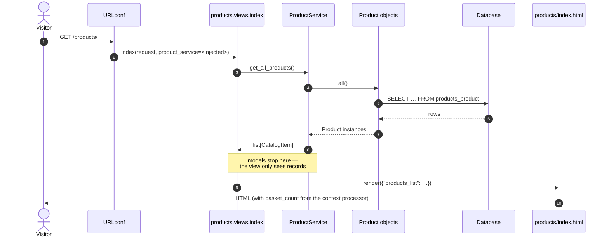

## 7. Example Flow: Adding To The Basket

`POST /orders/add_to_basket` with `product_id`

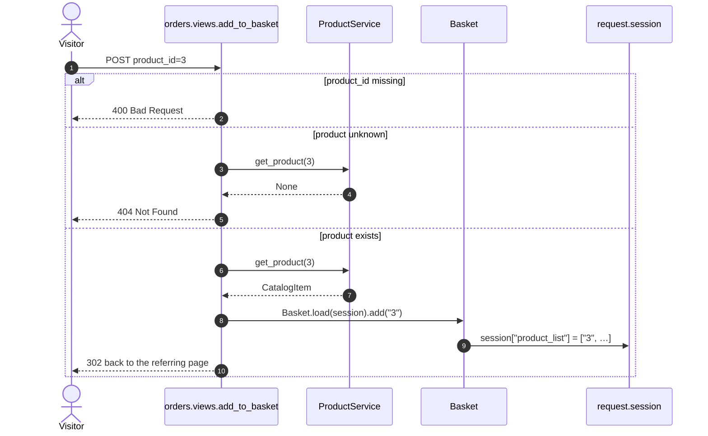

Nothing is written to the database. The basket is **session state**: a list of product id strings under
one key. Pricing happens later and on demand.

## 8. Example Flow: Placing An Order

`POST /orders/place_order` — the most interesting path in the project, because it is where a transaction,
a business rule and error handling meet.

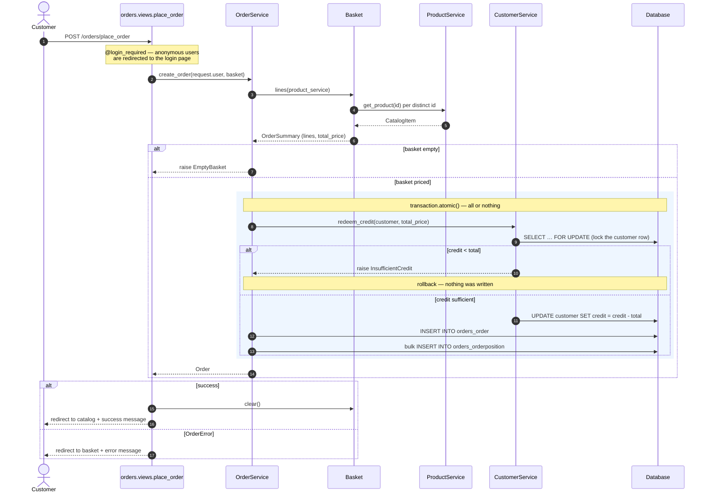

Three design decisions are visible here, and they are the ones to remember:

1. **One transaction owner.** `OrderService.create_order` opens the single `transaction.atomic()` block.
   `CustomerService.redeem_credit` also uses `atomic()`, but nested inside a caller's transaction that
   becomes a *savepoint*, not a second transaction. Exactly one place decides what "all or nothing" means.
2. **Credit first.** Redemption happens before the order rows are written, so an `InsufficientCredit`
   aborts before anything exists.
3. **`select_for_update()`.** The customer row is locked while credit is checked and deducted. Without
   it, two concurrent orders could both read the same balance and both succeed — the classic lost-update
   race. `customers/test_concurrency.py` demonstrates it: eleven threads redeem from a credit that covers
   ten. Only a database with row locks serializes them (`just test-mariadb`); SQLite has no
   `select_for_update()`, so there the test checks only that no redemption is lost.

---

## 9. Running The Application

```bash
uv sync            # create .venv and install dependencies
just migrate       # create the database tables
just adminuser     # create an admin/customer
just seed          # load products/data/catalog.json
just runserver     # http://localhost:8000
```

Give the new customer some credit in the admin site (`/admin/`), or orders will be rejected — which is
itself a useful thing to see once.

**Migrations** deserve a note. Every model change needs `manage.py makemigrations`, which writes a file
into `<app>/migrations/`. Those files are versioned code: they are the history of the schema, are
committed to git, and `manage.py migrate` replays them. Never edit a migration that has been shared —
add a new one instead. The only exception is a deliberate reset of the whole history, as done once for
`customers`, `products` and `orders`: every existing database must then be recreated (see README, section 3.4).

`just compose` starts the deployment shape of the application, which is worth seeing at least once:

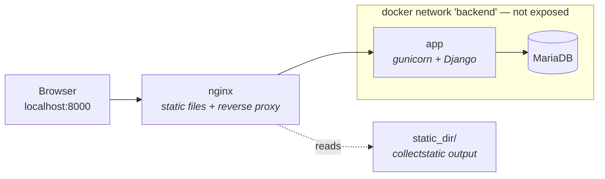

Only nginx publishes a port. The development server (`runserver`) is a convenience tool and serves static
files itself; in the container setup those two jobs are separated, which is how it is done in production.

---

## 10. Where To Add Code For A New Feature

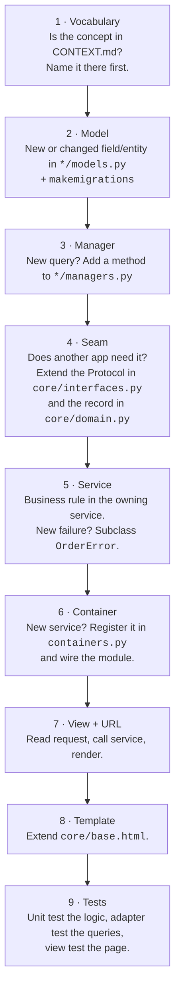

Step 4 is the one that is easy to skip and expensive to skip. If you extend a Protocol, **every** adapter
must follow — including the test doubles such as `InMemoryProducts` in `orders/test_basket.py`, otherwise
the interface is a lie.

Worked example, "products belong to a category": a `category` field on `products.Product` plus a
migration; a `get_by_category` method on `ProductManager`; a `category` field on `CatalogItem` and a
`get_products_by_category` method on the `ProductCatalog` Protocol, implemented in **both**
`ProductService` and the `InMemoryProducts` test double; a filter parameter in `products.views.index`; a filter
control in the template; tests at each level.

---

## 11. What To Remember

- **URLs** map paths to views; each app owns its own `urls.py`.
- **Views** are thin: read the request, call a service, render a template.
- **Services** hold the business rules and own the transactions.
- **Managers** hold the queries — they are this project's repositories.
- **Models** describe stored data; **records** in `core/domain.py` describe transferred data.
- **Interfaces** (`Protocol`s) are the seams between apps; an app never imports another app's models.
- **The container** decides which implementation fills which seam, in one place, at startup.
- **Templates** render HTML on the server; the layout lives in `core/base.html`.
- **Tests** mirror the layers, and every adapter proves it satisfies its Protocol.

When something is confusing, follow one request from the outside inwards and back: URL → view → service →
manager → model → database → record → template → HTML. That path is the backbone of the whole
application.
