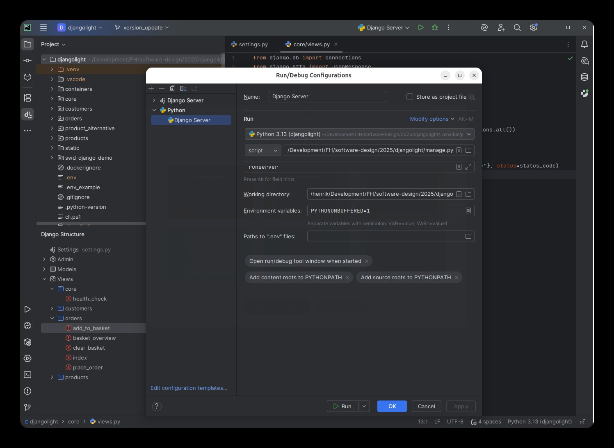
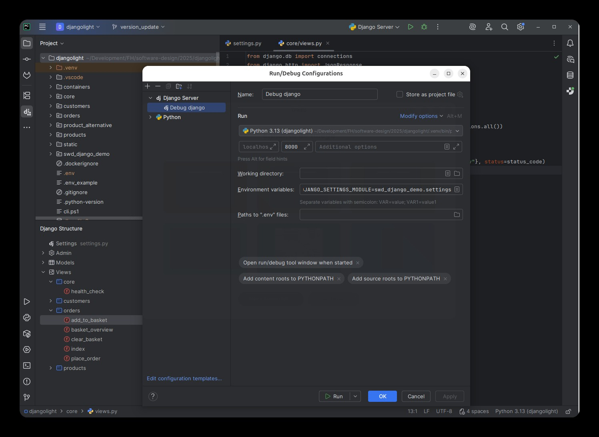
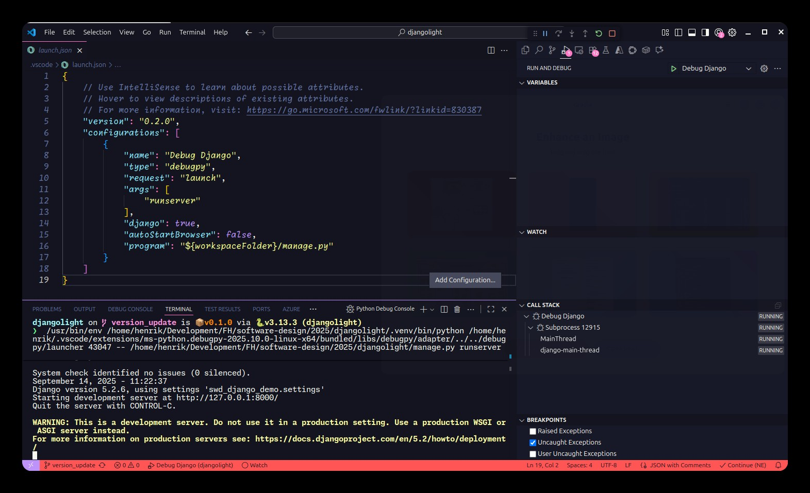

# SWD-LB-01: Introduction to Python/Django Implementation

**Course:** Software Design (SWD) Lab  
**Instructors:** Bernhard Danninger, Josef Lettner, Henrik Binggl  
**Version:** Updated for Current Codebase (2026)

---

## Goal of This Unit

> **You will be able to:** set up the toolchain, get the demo project running locally and start and debug it from your IDE.
>
> **You hand in (as part of the final zip):**
> - the running starter project (you keep working in this repository for the whole lab)
> - project setting, context diagram and requirements of your own ITS project (modelling part)
>
> The final submission is a zip file handed in before session 9, together with a short presentation.

---

## 1. Session Overview

| Unit | Topics | Tasks |
|---|---|---|
| 1 | Intro, Context Diagrams, Requirements, Demo Project | Modelling: project setting, context diagram, requirements. Coding: install tools and get starter project running |
| 2 | Use-Case-Diagrams | Modelling: 1 use-case diagram. Coding: get familiar with the demo project |
| 3 | Class-Diagrams & Unit-Tests | Modelling: 1 class diagram (business objects). Coding: start creating persistence layer and unit tests |
| 4 | Component-Diagrams | Modelling: 1 component diagram. Coding: start creating services/components on top of the models |
| 5 | Activity- & Sequence-Diagrams | Modelling: 1 activity & 1 sequence diagram. Coding: implement the service logic |
| 6 | Implementation | Rework the design. Coding: implement the frontend (Model-View-Template) and the UI unit tests |
| 7 | Design-Patterns | Identify and apply the design patterns in your implementation |
| 8 | Implementation | Finish implementation, add logging |
| 9 | Outlook | Short presentation. Final project submission (as zip file before session) |
| 10 | Test | — |

> **Note:** This is the overall planning for the lab. The order and the contents of the
> individual sessions may still change as the lab progresses — always follow the current
> handout and the announcements on Moodle.

---

## 2. Software Requirements & Tooling

### 2.1 Python Environment
- **Python Version:** 3.14 (pinned in `.python-version`)
- **Python Downloads:** [python.org/downloads](https://www.python.org/downloads/) (you do not need to install Python yourself, `uv` does it for you)
- **Dependency Management:** [uv](https://docs.astral.sh/uv/) - Modern Python package manager and virtual environment tool

### 2.2 Development Tools

| Tool | Purpose | Notes |
|---|---|---|
| **uv** | Python version management, virtual environments, package management | Replaces pip + virtualenv |
| **just** | Task runner for common commands | Cross-platform, simple syntax |
| **Git** | Version control | [https://git-scm.com/](https://git-scm.com/) |
| **Terminal** | Command-line interface | See below for platform-specific recommendations |

#### Terminal Recommendations
- **Windows:** PowerShell 7 + [Windows Terminal](https://learn.microsoft.com/en-us/windows/terminal/)
- **macOS/Linux:** Any terminal with bash or zsh (Terminal, iTerm2, Konsole, GNOME Terminal, Alacritty)

### 2.3 IDE Support

#### PyCharm (Community or Professional)
**Setup:**
1. Open the project folder in PyCharm
2. After `uv sync`, add interpreter:
   - Settings → Project: *djangolight* → Python Interpreter → Add Interpreter → Add Local Interpreter
   - Type: *uv*
   - Select existing environment: `.venv/bin/python` (Linux/macOS) or `.venv\Scripts\python.exe` (Windows)
3. **Professional Edition** may auto-detect Django project

**Run/Debug Configuration:**
- **Option 1 (both editions):**
  - Use Python
  - Script: `manage.py`
  - Parameter: `runserver`
- **Option 2 (Professional only):**
  - Use Django Server
  - Install Django support when prompted




#### VS Code
**Setup:**
- Repository includes `.vscode/` with settings, launch configurations, and extension recommendations
- Unit tests appear in Test Explorer (configured via `.vscode/django-tests.env`)

**Run/Debug Configuration:**
1. Create launch configuration:
   - Program: `manage.py`
   - Arguments: `runserver`
2. **Important:** Start VS Code from folder with activated virtual environment, OR select the virtual environment from the selection list (bottom right)



---

## 3. Assignment: ITS-Project Implementation

### 3.1 Get Started

#### Step 1: Install Required Tools
- [ ] Modelling Tool (Enterprise Architect or [draw.io](https://draw.io/))
- [ ] [uv](https://docs.astral.sh/uv/getting-started/installation/)
- [ ] Python 3.14 (automatically handled by uv)
- [ ] IDE (PyCharm or VS Code)
- [ ] Git
- [ ] Decent terminal (see above)

#### Step 2: Get the Starter Project
```bash
# Clone from FH GitLab
git clone https://its-git.fh-salzburg.ac.at/SWD/djangolight
cd djangolight
```

#### Step 3: Open Project in IDE
- **PyCharm:** File → Open → Select project folder
- **VS Code:** `code djangolight`

### 3.2 Run the Application

#### Using `just` (Recommended)

Run `just` without arguments to list all available recipes:

```bash
just
```

| Recipe | Description |
|---|---|
| `just migrate` | Create/update database tables (SQLite file `db.sqlite3`) |
| `just adminuser` | Create an admin user interactively |
| `just seed` | Load initial product catalog from `products/data/catalog.json` |
| `just test` | Run the test suite verbosely |
| `just runserver` | Start development server on `http://localhost:8000` |
| `just compose` | *Optional:* collect the static files and run the app in Docker containers. Not needed for the lab — ignore it unless it is introduced in a later session |
| `just test-mariadb` | *Optional:* run the test suite against MariaDB in Docker containers, like production. Not needed for the lab |

**First Start (Complete Setup):**
```bash
uv sync           # Create .venv and install dependencies
just migrate      # Create database tables
just adminuser    # Create admin user
just seed         # Load product catalog
just runserver    # Start development server
```

#### Using Direct Django Commands

All recipes are `manage.py` calls run through `uv run`:

```bash
# Database operations
uv run python manage.py migrate
uv run python manage.py createsuperuser
uv run python manage.py seed_catalog [--file path/to/items.json]

# Testing
uv run python manage.py test -v 2
uv run python manage.py test orders.test_basket.TestBasketLines

# Server
uv run python manage.py runserver

# Utility
uv run python manage.py showmigrations      # Show applied migrations
uv run python manage.py makemigrations      # After model changes
uv run python manage.py shell               # Python shell with Django loaded
```

### 3.3 Access the Application

After starting the server:
- **Admin Site:** [http://localhost:8000/admin](http://localhost:8000/admin)
- **Demo App (Products):** [http://localhost:8000/products](http://localhost:8000/products)
- **Site Root:** [http://localhost:8000](http://localhost:8000) (redirects to the product catalog)

**Login:** Use the admin user created with `just adminuser` or `createsuperuser`  
**Note:** Customers need credit to place orders. Set credit in the admin site on the customer record.

---

*Updated to match current djangolight codebase*  
*Last updated: 2026-09-06*