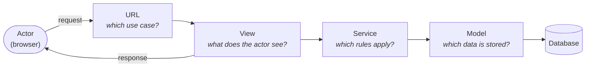
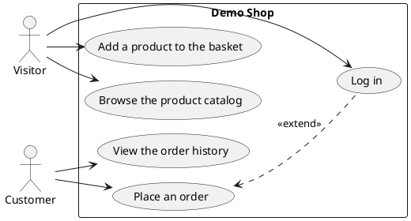

# SWD-LB-02: Use-Case-Diagrams in Python/Django

**Course:** Software Design (SWD) Lab  
**Instructors:** Bernhard Danninger, Josef Lettner, Henrik Binggl  
**Version:** Updated for Current Codebase (2026)

---

## Goal of This Unit

> **You will be able to:** read a use-case diagram off a running system, find your way around the demo project, debug it and set up your own project.
>
> **You hand in after this unit:**
>
> - the URL of the Git repository that holds your own project
>
> **You hand in (as part of the final zip):**
>
> - 1 use-case diagram for your own ITS project
> - a short note on which two (non-trivial) use cases you will implement
>
> The final submission is a zip file handed in before session 9, together with a short presentation.

---

## 1. Session Overview

| Unit | Topics | Tasks |
|---|---|---|
| 1 | Intro, Context Diagrams, Requirements, Demo Project | Modelling: project setting, context diagram, requirements. Coding: install tools and get starter project running |
| 2 | Use-Case-Diagrams | Modelling: 1 use-case diagram. Coding: get familiar with the demo project, set up your own project and Git repository |
| 3 | Class-Diagrams & Unit-Tests | Modelling: 1 class diagram (business objects). Coding: start creating persistence layer and unit tests |
| 4 | Component-Diagrams | Modelling: 1 component diagram. Coding: start creating services/components on top of the models |
| 5 | Activity- & Sequence-Diagrams | Modelling: 1 activity & 1 sequence diagram. Coding: implement the service logic |
| 6 | Implementation | Rework the design. Coding: implement the frontend (Model-View-Template) and the UI unit tests |
| 7 | Design-Patterns | Identify and apply the design patterns in your implementation |
| 8 | Implementation | Finish implementation, add logging |
| 9 | Outlook | Short presentation. Final project submission (as zip file before session) |
| 10 | Test | — |

> **Note:** This is the overall planning for the lab. The order and the contents of the
> individual sessions may still change as the lab progresses — always follow the current
> handout and the announcements on Moodle.

---

## 2. Useful Information

The following resources accompany this lab on Moodle and in the project:

- **Project structure** of the demo project (see the `djangolight` repository and its `README.md`)
- **How to create a new Django project** (see the official [Django tutorial](https://www.djangoproject.com/start/))
- **Most important Django commands** (see `just` recipes and `manage.py` calls below)

---

## 3. Use-Case Diagrams

### 3.1 What a Use-Case Diagram Is

- A use-case diagram captures the **functional requirements** of a system from the user's point of view
- It shows **actors** (who interacts with the system) and **use cases** (what they can do)
- It does **not** describe implementation details or the internal flow
- [UML Use-Case Diagrams Overview](https://www.uml-diagrams.org/use-case-diagrams.html)

### 3.2 Actors in the Demo Project

The demo shop distinguishes two roles. They are taken from the project's domain vocabulary in `CONTEXT.md`:

| Actor | Description |
|---|---|
| **Visitor** | Someone using the shop who is not logged in. May browse and fill a basket but cannot place an order. |
| **Customer** | A person who can place orders. The same person logs in to the shop; there is no separate notion of a user or shop account. |

### 3.3 Use Cases in the Demo Project

Each use case of the demo can be reached in the browser under its own address:

| Use Case | Actor | Address |
|---|---|---|
| Browse the product catalog | Visitor, Customer | `/products/` |
| Add a product to the basket | Visitor, Customer | `/orders/add_to_basket` |
| View the basket | Visitor, Customer | `/orders/basket_overview` |
| Clear the basket | Visitor, Customer | `/orders/clear_basket` |
| Place an order | Customer | `/orders/place_order` |
| View the order history | Customer | `/orders/my` |
| Log in | Visitor | `/admin/login/` |
| Log out | Customer | `/logout` |

A **visitor** can browse, fill and clear the basket, but only a **customer** (logged in) can place an order and view the order history. Placing an order redeems credit; an empty basket cannot be placed.

The demo has **no login page of its own**: it reuses the login page of Django's admin site (`/admin/login/`) to keep the demo small.

Two routes exist that are not use cases: the site root `/`, which only redirects to the catalog, and `/health`, a health check for the container setup.

### 3.4 How Django Handles a Use Case — the Big Picture

You do not need to know Django yet. For now it is enough to know **which building blocks exist** and **which question each one answers**. Each of them gets its own lab later, in this order: models first, then services, then views.

Whenever an actor does something in the browser, the browser sends a **request** to the server, and Django answers with a **response** (usually an HTML page). In between, the request passes these building blocks:



| Building block | Question it answers | File in each app | Covered in |
|---|---|---|---|
| **Model** | Which data does the system store? | `models.py` | next lab |
| **Service** | Which business rules apply? | `services.py` | after the models |
| **View** + **Template** | What does the actor send and see? | `views.py`, `templates/` | after the services |
| **URL** | Which address belongs to which use case? | `urls.py` | together with the views |

A Django **project** is split into **apps**. Each app groups related use cases and the data they need:

| App | Use cases |
|---|---|
| `products` | Browse the product catalog |
| `orders` | Add to / view / clear the basket, place an order, view the order history |
| `customers` | (no page of its own) holds the customer and their credit, used by *Place an order* |

### 3.5 Walkthrough: Place an Order

Here is *Place an order* again, first as the customer sees it, then as the system handles it. There is no code here. The point is to see that each step of a use case ends up in a particular building block.

| Step | What happens | Building block |
|---|---|---|
| 1 | The customer clicks *Place order* on the basket page; the browser sends a request to `/orders/place_order` | URL |
| 2 | The system checks that the actor is logged in. A visitor is sent to the login page instead | View |
| 3 | The basket is priced. An empty basket, or a total higher than the customer's credit, is rejected | Service |
| 4 | The credit is redeemed and the order with its order lines is stored, both or neither | Model / Database |
| 5 | The customer sees a confirmation, or a message explaining why the order was rejected | View + Template |

The parts of a use-case description show up again in the implementation:

| In the use-case description | In the running system |
|---|---|
| Actor *Customer* (not *Visitor*) | Login check before anything else happens |
| Precondition *basket is not empty* | A business rule in the service |
| Alternative flow *not enough credit* | An error message shown to the customer |
| Postcondition *order is recorded, credit is reduced* | New rows in the database |

**Try it with the debugger:**

1. Open `orders/services.py` and set a breakpoint on the first line of `create_order`.
2. Log in, put a few products into the basket and place the order.
3. When the debugger stops, look at the variables: who the customer is and what is in the basket. Step over the lines until the order is stored.
4. Set the customer's credit to `0` in the admin site and repeat. Watch where the alternative flow leaves the normal path.

You are not expected to understand every line. Follow the path, and recognise the steps from the table above.

### 3.6 Describe Your Own Use Cases

Before anything is implemented, describe each use case in words. Fill in one table per use case:

| Field | Example: *Place an order* |
|---|---|
| **Name** (verb + object) | Place an order |
| **Actor(s)** | Customer |
| **Precondition** | Customer is logged in; basket is not empty |
| **Main success scenario** | 1. Customer opens the basket. 2. Customer places the order. 3. System confirms the order. |
| **Alternative flows** | Not enough credit → order is rejected, the customer sees why |
| **Postcondition** | Order is recorded; credit is reduced by the order total |
| **Data involved** | Customer, credit, product, price, order, order line |

Tips:

- Use the words of your domain consistently, the way `CONTEXT.md` does for the demo shop. Pick one term per concept and stick to it (*basket*, not sometimes *cart*).
- The **Data involved** row is the bridge to the next lab: the nouns that keep coming up there (customer, order, product, ...) are the candidates for your **models**.

### 3.7 Tools for Use-Case Diagrams

Any tool that draws actors, use cases and a system boundary will do. Store the diagram **in your Git repository** next to the code, so it evolves with the project.

| Tool | Kind | Good for |
|---|---|---|
| [draw.io](https://www.drawio.com/) | Graphical, UML shape library | **Default choice.** Free, runs in the browser and as a desktop app |
| [PlantUML](https://plantuml.com/use-case-diagram) | Text-based (diagram as code) | Diagrams versioned as text in Git, with readable diffs |
| [Visual Paradigm Community Edition](https://www.visual-paradigm.com/download/community.jsp) | Graphical, UML-aware | Checks the UML notation for you; free for non-commercial use |
| [Enterprise Architect](https://www.sparxsystems.com/) | Full UML modelling tool | Keeping all diagrams of the following labs (component, class, sequence) in one model |
| [Excalidraw](https://excalidraw.com/) | Whiteboard, hand-drawn style | Sketching a first draft in class; it does not check UML notation, so draw the final diagram in one of the tools above |

**draw.io tip:** with the [Draw.io Integration](https://marketplace.visualstudio.com/items?itemName=hediet.vscode-drawio) extension, VS Code edits `*.drawio.svg` files directly. Such a file is a normal SVG image that GitLab displays, and it can still be opened and edited again later.

**PlantUML example:** the demo shop as text. Plugins for PyCharm and VS Code show a live preview; PlantUML needs Java, and `!pragma layout smetana` avoids the extra Graphviz installation.



> **Note:** Mermaid, which this project uses for its other diagrams, has no use-case diagram type.
> A flowchart can imitate one, but without real actor symbols or a system boundary.

---

## 4. Familiarize with the Demo Project

### 4.1 Understanding the Architecture

- The demo project is a small web shop where customers browse a product catalog, fill a basket, place orders and pay with prepaid credit
- The project is deliberately structured into **loosely coupled apps** that talk to each other through small interfaces instead of importing each other's models
- The domain vocabulary (catalog, basket, order line, credit, ...) is defined in `CONTEXT.md` in the project root

| App | Responsibility |
|---|---|
| `core` | The seams between the apps: interfaces, domain records, abstract base models, site root and health check |
| `products` | The product catalog: model, repository, the `ProductService` adapter and the listing page at `/products/` |
| `customers` | The customer (also the Django user model) and the `CustomerService` adapter for credit handling |
| `orders` | The basket (session), order placement and the order history, with their pages under `/orders/` |
| `swd_django_demo` | The Django project: settings, URL configuration and the dependency-injection container |

### 4.2 Further Reading

- [Official Django tutorial](https://www.djangoproject.com/start/) — to get an idea of how Django projects look
- [MDN Django tutorial](https://developer.mozilla.org/en-US/docs/Learn_web_development/Extensions/Server-side/Django) — builds a complete *Local Library* site step by step: project skeleton, models, admin site, views, sessions, login, forms, tests. It follows the same order as this lab (models first, views later), so you can read along unit by unit

### 4.3 Debugging the Application

Make sure you are able to debug the application:

- Set a **breakpoint** somewhere in the code
- Start the application in **debug mode**
- Navigate through the application to the point where the breakpoint is set

Run the development server:

```bash
just runserver
# or
uv run python manage.py runserver
```

---

## 5. Set Up Your Own Project

Your ITS project lives in its **own Git repository** from the start. There are two ways to begin; both are fine, pick the one that suits your team.

| | A: Start from the demo | B: Start from scratch |
|---|---|---|
| **Idea** | Copy the demo, add your own apps next to the sample apps, remove the sample logic at the end | Create an empty Django project and add your own apps step by step |
| **Pro** | Runs from day one; settings, test setup, `justfile`, containers and the layered structure are already there | You understand every file, because you created it; nothing to clean up later |
| **Con** | Many files you do not understand yet; sample code must be removed before the final submission | More setup work; you add structure (services, tests, containers) yourself as the labs progress |

### 5.1 Option A: Start from the Demo

1. Copy the demo **without** its Git history and start a fresh repository:

   ```bash
   git clone https://its-git.fh-salzburg.ac.at/SWD/djangolight.git my-its-project
   cd my-its-project
   rm -rf .git          # PowerShell: Remove-Item -Recurse -Force .git
   git init
   ```

2. Check that everything still runs: `just migrate`, `just test`, `just runserver`.
3. Add your own app next to the sample apps and register it in `INSTALLED_APPS` in `swd_django_demo/settings.py`:

   ```bash
   uv run python manage.py startapp <your_app>
   ```

4. Use the sample apps as a reference while you build yours. **Before the final submission, remove the sample logic** (`products`, `orders` and every reference to them in `settings.py`, the URL configuration, the DI container and `core`). Search the project for the app names to find them all.

> **Note:** `customers` is not just sample logic: its `Customer` model is the user model that logs in
> (`AUTH_USER_MODEL` in the settings). Adapt it to your project instead of deleting it.

### 5.2 Option B: Start from Scratch

```bash
uv init my-its-project
cd my-its-project
uv add django
uv run django-admin startproject its_project .     # the project: settings, root URLs
uv run python manage.py startapp <your_app>          # one app per area of your domain
uv run python manage.py migrate
uv run python manage.py runserver
```

- Register each new app in `INSTALLED_APPS` in `its_project/settings.py`.
- `uv init` creates a `main.py` you do not need; delete it.
- Copy the `.gitignore` from the demo (it keeps `.venv/`, `db.sqlite3` and `__pycache__` out of the repository).
- The [official Django tutorial](https://docs.djangoproject.com/en/stable/intro/tutorial01/) walks through exactly these first steps.

### 5.3 Create the Git Repository

1. Create an **empty** project on [its-git.fh-salzburg.ac.at](https://its-git.fh-salzburg.ac.at) (no README, so the first push does not conflict).
2. Give your team members and the lab instructors access.
3. Connect your local project and push it:

   ```bash
   git add .
   git commit -m "Initial project setup"
   git branch -M main
   git remote add origin <your-repository-url>
   git push -u origin main
   ```

4. Check in the web interface that `.venv/` and `db.sqlite3` are **not** in the repository.
5. Hand in the repository URL.

From now on, commit small steps regularly. The history shows how your project evolved over the labs.

---

## 6. Most Important Django Commands

All recipes are `manage.py` calls run through `uv run`:

```bash
uv run python manage.py migrate            # Create/update database tables (SQLite file db.sqlite3)
uv run python manage.py createsuperuser    # Create an admin user interactively
uv run python manage.py seed_catalog       # Load the initial product catalog
uv run python manage.py runserver          # Start development server on http://localhost:8000
uv run python manage.py test -v 2          # Run the test suite verbosely
uv run python manage.py showmigrations     # Show applied migrations
uv run python manage.py makemigrations     # Create migrations after model changes
uv run python manage.py shell              # Python shell with Django loaded
```

Or use the `just` task runner (`just` lists all recipes):

| Recipe | Description |
|---|---|
| `just migrate` | Create/update database tables |
| `just adminuser` | Create an admin user interactively |
| `just seed` | Load the initial product catalog |
| `just test` | Run the test suite verbosely |
| `just runserver` | Start the development server |

---

## 7. Access the Application

After starting the server:

- **Admin Site:** [http://localhost:8000/admin](http://localhost:8000/admin)
- **Product Catalog:** [http://localhost:8000/products](http://localhost:8000/products)
- **Site Root:** [http://localhost:8000](http://localhost:8000) (redirects to the product catalog)

**Login:** Use the admin user created with `just adminuser` or `createsuperuser`  
**Note:** Customers need credit to place orders. Set credit in the admin site on the customer record.

---

## 8. Assignment: ITS-Project Implementation

### 8.1 Tasks

- [ ] Familiarize yourself with the demo project
  - [ ] Read the `README.md` and `CONTEXT.md` to understand the domain vocabulary
  - [ ] Go through the [official Django tutorial](https://www.djangoproject.com/start/) to get an idea of how Django projects look
  - [ ] Or work through the first parts of the [MDN Django tutorial](https://developer.mozilla.org/en-US/docs/Learn_web_development/Extensions/Server-side/Django) (introduction up to *Using models*)
- [ ] Make sure you are able to debug the application
  - [ ] Set a breakpoint somewhere in the code
  - [ ] Start the application in debug mode
  - [ ] Navigate through your application to the point where the breakpoint is set
- [ ] Draw a use-case diagram for your own project
  - [ ] Identify the actors of your system
  - [ ] Identify the use cases (what each actor can do)
  - [ ] Use a modelling tool (see section 3.7) and store the diagram in your Git repository
- [ ] Follow *Place an order* through the demo with the debugger (section 3.5)
- [ ] Describe the two use cases you will implement with the table in section 3.6, including the data involved
- [ ] Set up your own project (section 5)
  - [ ] Decide: start from the demo (option A) or from scratch (option B)
  - [ ] Create the Git repository and push the initial project
  - [ ] Make sure the project starts with `runserver`
  - [ ] Hand in the repository URL

### 8.2 Key Concepts to Demonstrate

- **Actors** and **use cases** of your system
- **Data involved** in each use case (input for the models in the next lab)
- **Separation of concerns** between business logic and the Django layer
- **Debugging** the application in your IDE
- **Your own project** in a Git repository, runnable with `runserver`

---

*Updated to match current djangolight codebase*  
*Last updated: 2026-10-02*
